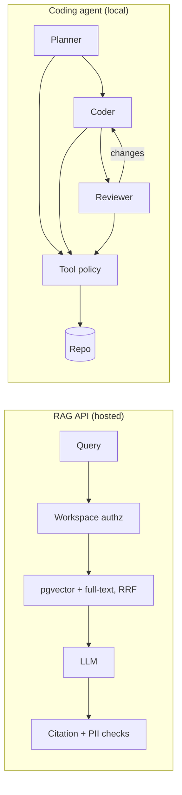

# Grounded Agent Platform

[](https://github.com/FarnazNK/grounded-agent-platform/actions/workflows/ci.yml)
[](https://github.com/FarnazNK/grounded-agent-platform/actions/workflows/security.yml)
[](https://github.com/FarnazNK/grounded-agent-platform/actions/workflows/frontend.yml)

A multi-tenant RAG API and a policy-controlled coding agent. The model proposes; code outside the model decides what it may see, call and claim.

[Web demo](https://grounded-agent-web.vercel.app) · [API docs](https://grounded-agent-api.vercel.app/docs)

## Quickstart

```bash
docker compose up -d --build
docker compose exec api alembic upgrade head
```

Then open http://localhost:8000/docs. The agent runs from the CLI:

```bash
pip install -e '.[dev]'
rag-agent dev-team --repo . --task "Trace how request authentication is enforced"
```

Both run offline with deterministic providers. To use Anthropic or OpenAI, set the `APP_LLM_*` variables in [`.env.example`](.env.example).

## Architecture



## Results

60-document corpus, 18 answerable questions: **recall@4 0.94**, MRR 0.72. Query p95 latency **5.4 ms** in-process. CI blocks merges on retrieval, groundedness, agent-context and latency regressions. Reproduce with `make eval-full benchmark`.

## Design decisions

- **Hybrid retrieval:** vectors catch paraphrases, full-text catches exact terms ([ADR 0001](docs/adr/0001-hybrid-retrieval.md)).
- **One Postgres for data, vectors and search:** one system to run and secure ([ADR 0002](docs/adr/0002-pgvector.md)).
- **Policy in code, not prompts:** the reviewer agent can't write files even if its prompt is injected.
- **Outputs are validated:** an answer must cite the documents it was given.

## Limitations

- Out-of-scope questions still get an answer (1 of 5 refusal cases pass). Next fix: a relevance threshold before generation.
- Prompt-injection screening is regex-based and misses indirect attacks.
- The agent's tool policy is not an OS sandbox.

## Docs

[Architecture](docs/architecture.md) · [Developer agent](docs/developer-agent.md) · [Observability](docs/observability.md) · [Deployment](docs/deployment.md) · [Limitations](docs/limitations.md) · [Optional demos](docs/optional-demos.md)
