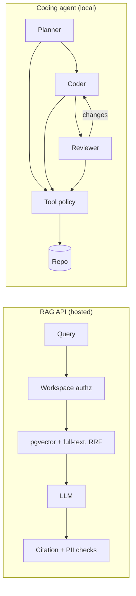

# Grounded Agent Platform

[](https://github.com/FarnazNK/grounded-agent-platform/actions/workflows/ci.yml)
[](https://github.com/FarnazNK/grounded-agent-platform/actions/workflows/security.yml)
[](https://github.com/FarnazNK/grounded-agent-platform/actions/workflows/frontend.yml)

A multi-tenant RAG API and a policy-controlled coding agent. The model proposes; code outside the model decides what it may see, call and claim.

[Web demo](https://grounded-agent-web.vercel.app) · [API docs](https://grounded-agent-api.vercel.app/docs)

## Technology stack

| Area | Technologies |
| --- | --- |
| Backend | Python 3.11+, FastAPI, Pydantic, SQLAlchemy, Alembic |
| Retrieval & storage | PostgreSQL, pgvector, full-text search, weighted reciprocal-rank fusion |
| Models | Deterministic test providers; optional OpenAI and Anthropic adapters |
| Developer agent | Repository context selection, planner/coder/reviewer workflow, tool policy, verification |
| Web demo | React, TypeScript, Vite (browser-only) |
| Testing & operations | pytest, Ruff, mypy, GitHub Actions, Docker, Prometheus; optional Grafana and Langfuse |

## What runs where

| Component | Where it runs | What it demonstrates |
| --- | --- | --- |
| RAG API | Hosted on Vercel; also runnable locally | Authenticated, workspace-scoped retrieval and generation backed by PostgreSQL/pgvector |
| Web demo | Hosted static React site; runs in the visitor's browser | Interactive deterministic retrieval simulation, citations, guardrails and local-file questions; **no backend API calls** |
| Developer agent | Local operator-controlled CLI | Policy-controlled repository tools and planner/coder/reviewer workflow; no hosted filesystem execution |
| AWS AgentCore, gRPC, Kubernetes and monitoring examples | Optional reference/local setups | Architectural and infrastructure demos; not all are part of the hosted service |

See [optional demos](docs/optional-demos.md) and [deployment notes](docs/deployment.md) for boundaries and setup details.

## Quickstart

```bash
docker compose up -d --build
docker compose exec api alembic upgrade head
```

To run the local developer agent:

```bash
pip install -e '.[dev]'
rag-agent dev-team --repo . --task "Trace how request authentication is enforced"
```

Both run offline with deterministic providers. To use Anthropic or OpenAI, set the `APP_LLM_*` variables in [`.env.example`](.env.example).

## Architecture



## Example grounded answer

From the [sample PTO policy](data/sample_corpus_extended/pto_policy.md), an **illustrative** question-and-answer pair (not a captured live API response):

> **Question:** How many PTO days do new hires get per year?
>
> **Answer:** New hires accrue 15 PTO days annually for their first two years. [source: pto_policy.md]

This is the expected citation format. Try the [web demo](https://grounded-agent-web.vercel.app) for interactive examples.

## Security and verification

- **Tenant boundaries:** JWT authentication, workspace-role checks and workspace-scoped retrieval.
- **Agent permissions:** read-only planner/reviewer roles, explicit write opt-in and constrained repository tools; **not an OS-level sandbox**.
- **Output checks:** PII redaction and citation validation; citations do not prove claim-level factual support.
- **CI:** unit and PostgreSQL integration tests, lint/type checks, retrieval and adversarial evaluations, latency benchmark, dependency scanning and Docker build.

## Results

60-document corpus, 18 answerable questions: **recall@4 0.94**, MRR 0.72. Query p95 latency **5.4 ms** in-process. CI blocks merges on retrieval, groundedness, agent-context and latency regressions. Run `make eval-full` for the extended evaluation report and `make benchmark` for a local latency run. **The extended evaluation is informational rather than a passing CI gate** (`eval-full` ignores the evaluator's exit code); results depend on environment and dataset.

## Design decisions

- **Hybrid retrieval:** vectors catch paraphrases, full-text catches exact terms ([ADR 0001](docs/adr/0001-hybrid-retrieval.md)).
- **One Postgres for data, vectors and search:** one system to run and secure ([ADR 0002](docs/adr/0002-pgvector.md)).
- **Policy in code, not prompts:** the reviewer agent can't write files even if its prompt is injected.
- **Outputs are validated:** an answer must cite the documents it was given.

## Limitations

- Out-of-scope questions still get an answer (1 of 5 refusal cases pass). Next fix: a relevance threshold before generation.
- Prompt-injection screening is regex-based and misses indirect attacks.
- The agent's tool policy is not an OS sandbox.

## Docs

[Architecture](docs/architecture.md) · [Developer agent](docs/developer-agent.md) · [Observability](docs/observability.md) · [Deployment](docs/deployment.md) · [Limitations](docs/limitations.md) · [Optional demos](docs/optional-demos.md)
