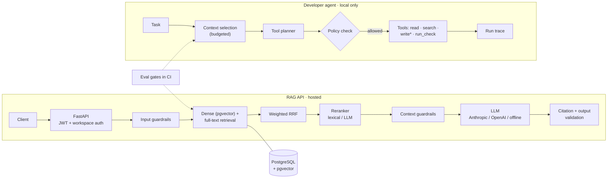

# Grounded Agent Platform

**An applied-AI backend for answers and actions you can trust.** A multi-tenant RAG API that answers only from documents a user is allowed to see, and a developer agent whose tool use is controlled by policy outside the model. Both are measured by evaluation gates in CI.

[](https://github.com/FarnazNK/grounded-agent-platform/actions/workflows/ci.yml)
[](https://github.com/FarnazNK/grounded-agent-platform/actions/workflows/security.yml)


**[🖥️ Live demo](https://grounded-agent-web.vercel.app)** · **[📘 Live API docs](https://grounded-agent-api.vercel.app/docs)** · **[💚 Health](https://grounded-agent-api.vercel.app/health/ready)** · **[🧠 Core code](src/rag_agent/)** · **[📊 Evaluations](scripts/)**

> **Two live pieces.** The [web demo](https://grounded-agent-web.vercel.app) (React + TypeScript, in [`frontend/`](frontend/)) traces every question step by step: guardrails, dense and lexical search, rank fusion, grounding and citation checks. It runs a browser port of the backend's deterministic pipeline, so it needs no sign-in and makes no API calls. The [hosted API](https://grounded-agent-api.vercel.app/docs) is the real Python backend.

---

## At a glance

| | |
| --- | --- |
| **What it is** | (1) A RAG API: upload documents per workspace, ask questions, get answers with checked citations. (2) A developer agent that reads code, proposes changes and runs tests, within strict rules. |
| **AI techniques** | Hybrid retrieval (pgvector + full-text) with reciprocal-rank fusion, second-stage reranking (lexical by default, LLM optional), citation validation, input/context/output guardrails, LLM-as-judge evaluation, tool-calling agent loop, reusable skills |
| **Backend** | Python, FastAPI, Pydantic, SQLAlchemy, PostgreSQL 16 + pgvector, Alembic, JWT |
| **Frontend** | React 18, TypeScript, Vite: a public demo that visualizes each pipeline step |
| **Models** | Anthropic or OpenAI adapters, plus deterministic offline providers for reproducible CI |
| **Quality** | 129 unit tests + PostgreSQL integration tests, RAG eval gates on 66 questions (including a 40-question held-out set), adversarial gate, agent context eval, p95 latency gate, mypy, CodeQL, pip-audit |
| **Deployed on** | Vercel: RAG API with Neon PostgreSQL/pgvector, plus the static web demo |

## What I built

### 🔎 Hybrid retrieval with checked citations
Dense search (pgvector) finds meaning; full-text search catches exact terms like policy names, acronyms and IDs. The two rankings are merged with **weighted reciprocal-rank fusion**, then a **second-stage reranker** reorders the short list before the answer is built. Before an answer goes out, its citations are **validated against the retrieved sources**, and PII filters run on the output. Retrieval and embedding caches invalidate automatically when a document is re-indexed.
→ [`src/rag_agent/retrieval.py`](src/rag_agent/retrieval.py), [`src/rag_agent/service.py`](src/rag_agent/service.py)

### 🔁 Reranking, measured before and after
Per-case eval results showed the real problem: the right document was almost always *retrieved*, but often ranked 2nd or 3rd, so the answer cited the wrong source. A deterministic **lexical reranker** (stemmed query coverage, rarer terms weighted, file-name matches) now reorders the candidates, with an **LLM reranker** available as an option. To check it isn't overfit, I wrote a **40-question held-out set** after tuning, against documents the tuning set doesn't cover.

| Answerable questions (offline) | No reranker | Lexical reranker |
| --- | ---: | ---: |
| Held-out set: citation correctness | 0.60 | **0.86** |
| Held-out set: MRR | 0.74 | **0.91** |
| Tuning set: citation correctness | 0.56 | **0.94** |
| Added p95 latency | | ~2-4 ms |

The held-out gain is the honest number. These runs use deterministic answers, so they measure ranking and citations, not answer quality. **[`scripts/run_model_eval.py`](scripts/run_model_eval.py)** and a manual **[`model-eval` workflow](.github/workflows/model-eval.yml)** repeat the comparison with a real model (Anthropic or OpenAI), add the LLM reranker, and grade every answer with an **LLM judge** against criteria written per question. Decision record: [ADR 0009](docs/adr/0009-lexical-reranking-default.md).
→ [`src/rag_agent/rerank.py`](src/rag_agent/rerank.py), [`src/rag_agent/evals/judge.py`](src/rag_agent/evals/judge.py), [`data/eval_datasets/hr_holdout.yaml`](data/eval_datasets/hr_holdout.yaml)

### 🏢 Multi-tenant by design
Organizations → workspaces → viewer/editor/admin memberships. Every upload, re-index, delete and query is **scoped to a workspace the user belongs to**. The app refuses to start in staging or production if the admin-bootstrap shortcut is switched on.
→ [`src/rag_agent/auth.py`](src/rag_agent/auth.py)

### 🤖 A developer agent where *the model proposes and policy decides*
The agent picks the most relevant files within a fixed context budget, then plans with narrow tools (`list_files`, `read_file`, `search_code`, `write_file`, `run_check`, `finish`). Every tool call is checked **outside the model**: it can't leave the repo, can't touch credential-like paths, can only run allowlisted test/lint commands **without a shell**, and **can't write at all unless the operator passes `--allow-writes`**. Each run produces a step-by-step trace. Reusable YAML skills (`code-change`, `debug`, `review`) bring their own tool allowlists.
→ [`src/rag_agent/agent/`](src/rag_agent/agent/), [`agent_skills/`](agent_skills/)

### 📏 AI quality measured in CI, not assumed
Every pull request must pass:

| Gate | What it checks | Result on the CI sets |
| --- | --- | --- |
| RAG quality (3 + 23 + 40 questions) | Right source retrieved, answer grounded, citations correct | core set 1.0; HR sets recall 1.0 / 0.97, citation correctness 0.94 / 0.86 |
| Adversarial | Prompt-injection and unsafe requests get blocked | all blocked |
| Agent context | Agent selects the correct files for known tasks (top-8) | 1.0 (threshold 0.75) |
| Latency | p95 request latency on the benchmark | ~4 ms (limit 500 ms) |

Plus Ruff, mypy, unit and PostgreSQL/pgvector integration tests, `pip-audit`, a production Docker build, and **CodeQL**. Reports are uploaded as CI artifacts.
→ [`scripts/run_evals.py`](scripts/run_evals.py), [`data/eval_datasets/`](data/eval_datasets/), [`.github/workflows/ci.yml`](.github/workflows/ci.yml)

### 🛡️ Layered guardrails, honestly labeled
Prompt-injection screening runs on user input **and** retrieved document text. It's regex-based, so it's treated as a first-pass filter that can be bypassed, **not** the security boundary. The real protection comes from authorization, tool policy and output validation.
→ [`src/rag_agent/guardrails/`](src/rag_agent/guardrails/)

## Architecture



\* writes only with `--allow-writes`. The repo-writing agent is never exposed on the hosted API.

## Try it

**Hosted:** open the **[interactive API docs](https://grounded-agent-api.vercel.app/docs)**. Main routes: `POST /v1/documents/upload`, `POST /v1/query`, `GET /v1/workspaces`, plus `/health/live`, `/health/ready` and `/metrics`.

**Locally** (Python 3.11+, PostgreSQL with pgvector)
```bash
make dev                 # install with dev extras
cp .env.example .env     # offline providers by default, no API key needed
make migrate             # create tables
make test                # unit tests
make eval-ci             # RAG (66 questions) + adversarial evaluation gates
```

**Run a real-model eval** (compares rerankers, grades answers with an LLM judge)
```bash
APP_LLM_PROVIDER=anthropic APP_LLM_MODEL=<model> \
APP_JUDGE_PROVIDER=anthropic APP_JUDGE_MODEL=<judge-model> \
  python scripts/run_model_eval.py --rerankers none lexical llm --judge \
    --input-price <usd-per-1M-in> --output-price <usd-per-1M-out>
```
Or run the **model-eval** workflow from the Actions tab after adding an `ANTHROPIC_API_KEY` or `OPENAI_API_KEY` secret. The report lands in the run summary.

**Run the developer agent** (read-only by default)
```bash
rag-agent dev-agent --repo . --task "Trace how request authentication is enforced"

# with a real model and a skill
APP_LLM_PROVIDER=anthropic APP_LLM_MODEL=<model> \
  rag-agent dev-agent --repo . --skill review --task "Review the auth path for security issues"
```

## Honest limitations

- **Offline vs. real-model evals:** CI runs deterministic answers, so it gates retrieval, ranking and citations, not answer quality. Answer quality comes from the real-model eval with an LLM judge, which costs API credits and runs manually; its results aren't published here yet.
- **Abstention:** the offline answer provider can't decline, so it fails the questions whose answer isn't in the corpus. Whether a real model correctly says "I don't know" is measured by the real-model eval.
- **Offline providers in the demo:** the hosted API uses deterministic embeddings and generation, so it shows the pipeline, not model-quality answers.
- **Agent sandboxing:** the agent's policy layer is defense in depth, not an OS sandbox. A hosted, write-enabled version would need ephemeral containers, network isolation and scoped credentials.

More detail: [`docs/limitations.md`](docs/limitations.md) and the architecture decision records in [`docs/adr/`](docs/adr/).

<details>
<summary><strong>Optional extras: AWS Bedrock/AgentCore, gRPC, Kubernetes, Prometheus/Grafana, Terraform</strong></summary>

None of these are deployed or needed to evaluate the project. All run locally without paid accounts.

- **AWS Bedrock + Strands + AgentCore:** a disabled-by-default, read-only, JWT/workspace-scoped agent reference with Bedrock Guardrails config. Run `python aws_agent/demo_offline.py`. Threat model and limitations in [`aws_agent/PORTFOLIO.md`](aws_agent/PORTFOLIO.md). Not deployed to AWS.
- **gRPC retrieval contract:** a Protocol Buffers service with deadlines and bearer metadata, on localhost only. Run `python -m grpc_demo.demo_offline`. See [`grpc_demo/retrieval.proto`](grpc_demo/retrieval.proto).
- **Kubernetes:** kind manifests with resource limits and secret references, validated in CI. See [`k8s/README.md`](k8s/README.md).
- **Prometheus + Grafana:** metrics for request latency, retrieval, model calls, tokens, ingestion and cache hits. See [`k8s/MONITORING.md`](k8s/MONITORING.md) and [`monitoring/`](monitoring/).
- **Terraform + AWS SAM/Lambda:** deployment scaffolding in [`infra/`](infra/), with a GitHub OIDC workflow.

</details>

## Repository guide

| Path | What's there |
| --- | --- |
| [`src/rag_agent/`](src/rag_agent/) | Retrieval, RAG service, auth, guardrails, evals, FastAPI app |
| [`src/rag_agent/agent/`](src/rag_agent/agent/) | Developer agent: context, planner, tools, policy, skills, harness |
| [`frontend/`](frontend/) | React + TypeScript web demo that traces the RAG pipeline |
| [`data/eval_datasets/`](data/eval_datasets/) | RAG quality and adversarial evaluation cases |
| [`tests/`](tests/) | Unit and PostgreSQL integration tests |
| [`docs/`](docs/) | Architecture, ADRs, developer-agent design, deployment, limitations |

---

Built by **Farnaz Nasehi** · [LinkedIn](https://www.linkedin.com/in/farnaz-nasehi/) · [GitHub](https://github.com/FarnazNK)
