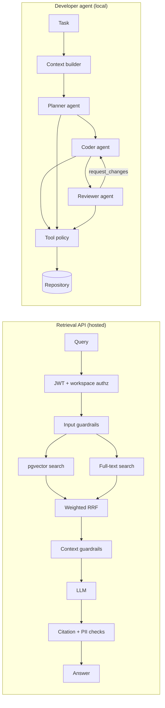

# Grounded Agent Platform

[](https://github.com/FarnazNK/grounded-agent-platform/actions/workflows/ci.yml)

A multi-tenant RAG API and a policy-controlled coding agent, built around one idea: the model proposes, and code outside the model decides what it may see, call and claim.

**Live:** [web demo](https://grounded-agent-web.vercel.app) · [API docs](https://grounded-agent-api.vercel.app/docs) · [health](https://grounded-agent-api.vercel.app/health/live)

## What it does

- **Retrieval API** (FastAPI, PostgreSQL + pgvector). Users upload documents into workspaces and ask questions. Answers are generated only from the caller's authorized workspace, must cite their sources, and are checked before they are returned.
- **Developer agent** (local CLI). An LLM works on a repository through a small set of tools (list, read, search, write, run checks). Every call passes a policy layer, writes need an explicit `--allow-writes`, and a planner → coder → reviewer team mode splits the work across agents with separate permissions.

Both surfaces run fully offline with deterministic model and embedding providers. CI and the hosted demo use those, so behavior is reproducible and costs nothing. Anthropic and OpenAI are drop-in through configuration.

## Quickstart

```bash
docker compose up -d --build                  # API :8000, Postgres, Prometheus :9090, Grafana :3000
docker compose exec api alembic upgrade head

API=http://localhost:8000
WS=$(curl -s $API/v1/auth/bootstrap -H 'content-type: application/json' -d '{
  "email": "admin@example.com", "password": "change-me-123",
  "organization_slug": "demo", "organization_name": "Demo",
  "workspace_slug": "default", "workspace_name": "Default"}' | jq -r '.workspaces[0].workspace.id')
TOKEN=$(curl -s $API/v1/auth/login -H 'content-type: application/json' \
  -d '{"email": "admin@example.com", "password": "change-me-123"}' | jq -r .access_token)

curl -s "$API/v1/documents/upload?workspace_id=$WS" -H "Authorization: Bearer $TOKEN" \
  -F file=@data/sample_corpus/pto_policy.md > /dev/null
curl -s $API/v1/query -H "Authorization: Bearer $TOKEN" -H 'content-type: application/json' \
  -d "{\"workspace_id\": \"$WS\", \"query\": \"How many PTO days do new hires get?\"}" | jq .result
```

Without Docker:

```bash
pip install -e '.[dev]'
pytest -q -m 'not integration'
rag-agent dev-team --repo . --task "Trace how request authentication is enforced"   # offline dry run
```

To use a real model, set `APP_LLM_PROVIDER=anthropic|openai`, `APP_LLM_MODEL` and the provider's API key. All settings are in [`.env.example`](.env.example).

## Architecture



## Results

Reproduce with `make eval eval-adversarial eval-full benchmark` and `python scripts/run_agent_evals.py`. All numbers use the deterministic providers (hashed-token embeddings, extractive answers), so they measure retrieval, guardrails and validation, not a language model.

| Suite | Cases | Result |
| --- | --- | --- |
| HR corpus, answerable questions (`hr_full.yaml`, 60 docs) | 18 | recall@4 **0.94**, MRR **0.72**, citation correctness **0.56** |
| HR corpus, should refuse (out-of-scope, missing doc, injection) | 5 | **1 of 5** refused (see limitations) |
| Core regression gate (`quality.yaml`) | 3 | recall, groundedness, citation correctness all 1.0 |
| Direct prompt injection (`adversarial.yaml`) | 3 | 3 of 3 blocked |
| Agent context selection (`context_selection.yaml`) | 4 | expected files in top 8: **4 of 4** |
| In-process query latency (50 requests, cache cleared) | 50 | p50 **3.3 ms**, p95 **5.4 ms** |

CI fails the build if recall, groundedness or answer relevance on the gate sets drops below its threshold, if agent context success falls under 0.75, or if p95 latency exceeds 500 ms.

## Design decisions

| Decision | Why | Trade-off |
| --- | --- | --- |
| Hybrid retrieval (pgvector + Postgres full-text, weighted RRF) | Dense search misses exact identifiers, acronyms and policy names; lexical search misses paraphrases | Two queries per request and fusion weights to tune ([ADR 0001](docs/adr/0001-hybrid-retrieval.md)) |
| One Postgres for data, vectors and text search | One system to run, back up and secure; tenant filters live in SQL next to the data | Less headroom than a dedicated vector store at very large scale ([ADR 0002](docs/adr/0002-pgvector.md)) |
| Authorization and tool policy enforced in code, not prompts | A model can be talked out of an instruction; it cannot bypass a path check | Every new tool needs an explicit policy rule |
| Model outputs are validated, not trusted | Citations must match retrieved sources; PII is redacted on the way out | Valid answers that cite loosely get flagged |
| Deterministic providers as first-class implementations | CI evals are repeatable and free; the hosted demo needs no API keys | Eval numbers say nothing about a real model's answer quality |
| Agent roles as separate harness runs with their own allowlists | The reviewer stays read-only even if writes are enabled or its prompt is injected | More model calls per task than a single loop |

## Developer agent

```bash
rag-agent dev-agent --repo . --skill review --task "Review the auth path for security issues"
rag-agent dev-team  --repo . --allow-writes --task "Add validation for the new field and test it"
```

`dev-agent` runs one agent with a reusable skill from [`agent_skills/`](agent_skills/). `dev-team` runs a read-only planner, a coder (the only role that can write), and a read-only reviewer that approves or sends feedback back for a bounded number of rounds. A shared step budget caps every run. Commands run without a shell, from an allowlist, with credentials stripped from their environment. Design and safety model: [docs/developer-agent.md](docs/developer-agent.md).

## Observability

- **Service health:** structured JSON logs with request and run IDs. Prometheus metrics cover latency, retrieval, model calls, tokens, cache hits and groundedness, with a Grafana dashboard in [`monitoring/`](monitoring/).
- **LLM tracing (optional, off by default):** [Langfuse](https://langfuse.com), self-hosted for free with `make langfuse-up`. Each RAG query and agent run becomes one trace with nested retrieval, agent and tool spans, model generations with token cost, and `grounded` / `review_approved` scores. If Langfuse is down, the app keeps working. Setup: [docs/observability.md](docs/observability.md).

## Limitations

- **No refusal gating.** With deterministic providers, out-of-scope questions and questions about missing documents still get an answer from the top-ranked chunk (4 of 5 refusal cases above fail). A relevance threshold before generation is the next fix.
- **Prompt-injection screening is regex-based.** It catches direct attempts but missed the indirect case in `hr_full.yaml`. It is a first-pass filter; the security boundary is authorization, tool policy and output validation.
- **The agent's tool policy is not an OS sandbox.** Run write-enabled agents in an ephemeral container or VM.
- **The hosted deployment** runs only the retrieval API with deterministic providers on Vercel Hobby and Neon. It has no SLA, and the developer agent is never exposed remotely.
- **The infrastructure examples are local only.** The Terraform/AWS SAM, Kubernetes, gRPC and Bedrock AgentCore examples run locally but are not deployed ([docs/optional-demos.md](docs/optional-demos.md)).
- **Scaling:** synchronous provider calls and a process-local rate limiter. The 10x/100x plans are in [docs/limitations.md](docs/limitations.md).

## Repository layout

```text
src/rag_agent/
  api/            FastAPI app, routes, Prometheus metrics
  service.py      RAG orchestration (guardrails → retrieval → generation → validation)
  retrieval.py    hybrid retrieval and fusion
  guardrails/     input, context and output checks
  agent/          context builder, planner, tools, policy, skills, harness, multi-agent team
  evals/          RAG scorers and runner
  tracing.py      optional Langfuse tracing
agent_skills/     declarative agent skills (YAML)
data/             sample corpora and eval datasets
frontend/         React demo (browser port of the deterministic pipeline)
monitoring/       Prometheus, Grafana, self-hosted Langfuse
infra/, k8s/      Terraform/AWS and local Kubernetes examples
docs/             architecture, ADRs, deployment, limitations
```

**Further reading:** [architecture](docs/architecture.md) · [ADRs](docs/adr/) · [deployment](docs/deployment.md) · [developer agent](docs/developer-agent.md) · [observability](docs/observability.md) · [limitations](docs/limitations.md)
